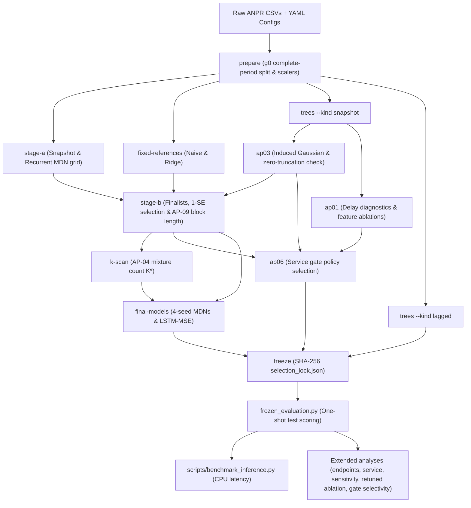

# Issue-Time ANPR Forecasting

[](https://doi.org/10.1016/j.trc.2026.106177)
[](https://www.sciencedirect.com/science/article/pii/S0968090X26006625)
[](https://chin1hanwu.github.io/issue-time-anpr-forecasting/)
[](https://www.python.org/)
[](LICENSE)

Official experiment code for **"Issue-Time Probabilistic Travel Time Forecasting under Completion Delay for an ANPR-Instrumented Urban Arterial"** (*Transportation Research Part C: Emerging Technologies*, 195, 106177, 2027 — [ScienceDirect](https://www.sciencedirect.com/science/article/pii/S0968090X26006625) | [Project Page](https://chin1hanwu.github.io/issue-time-anpr-forecasting/) · [Source](docs/index.html)).

---

## Overview

In Automatic Number Plate Recognition (ANPR) corridors, upstream entry timestamps are known immediately at forecast issue time $t$, whereas downstream arrival labels arrive only after each vehicle finishes traversing the link. Evaluating or featurizing traffic state using eventual matches leaks post-issue-time information. This repository enforces strict **issue-time observability** end to end across preprocessing, complete-period chronological splitting, validation-only selection, and confirmatory test evaluation.

### Key Components

- **Completion-aware state representation** (`data_processing.py`): 14-dimensional features per discrete update step $\Delta_{\text{obs}}$—upstream entries ($N_{\text{up}}$), completed matches by $t$ ($N_{\text{match}}$), completion ratio ($R_{\text{comp}}$), completed travel-time mean ($\bar{y}$) and variance ($s_y^2$) with training-segment fallback defaults, plus cyclical time-of-day (2D) and day-of-week (7D) encodings.
- **Probabilistic & point models** (`forecast_models.py`, `experiment_runner.py`, `r2_experiment_runner.py`):
  - Snapshot and Recurrent Mixture Density Networks (MDNs)
  - Shared-encoder point LSTM with training-residual Gaussian (`lstm_mse_gaussian`)
  - Naive marginal and Ridge Gaussian reference baselines
  - Quantile gradient-boosted trees (`HistGradientBoostingRegressor`) in snapshot, explicit-lag, quantile-induced Gaussian, and directly fitted $0.05/0.95$ interval-endpoint variants
- **Statistical & service-level evaluation** (`probabilistic_metrics.py`, `frozen_evaluation.py`):
  - Leakage-free chronological splitting along complete update-period boundaries
  - Gap-respecting moving-period-block bootstrap confidence intervals and Holm–Bonferroni multiplicity adjustments
  - Positive-support (zero-truncated) diagnostics alongside raw Gaussian/mixture scores
  - Period-weighted vs. trajectory-weighted service KPIs for availability gating and uniform interval scaling

### Headline Findings

On 113,006 matched trajectories from a Hangzhou signalized arterial (mean corridor travel time $\approx 81\text{ s}$):

- **No detectable look-ahead gain**: Across seven cadence/window settings ($\Delta_{\text{obs}} \in \{2, 5, 10\}\text{ min}$, $W \in \{5, 10, 15, 30, 60\}\text{ min}$), separately tuned comparisons detect no CRPS improvement from adding completions up to 30 minutes after the issue time (95% block intervals bound any gain at $\le 0.272\text{ s}$).
- **Signal concentrates in completed mean travel time**: Feature ablations locate predictive value primarily in the completed travel-time mean ($\bar{y}$).
- **Representation and density training matter**: Explicit-lag quantile GBDTs improve CRPS over the Recurrent MDN by $1.487\text{ s}$ (Holm-adjusted $p = 0.003$), and mixture-density training improves a shared recurrent encoder over MSE-based point training by $1.630\text{ s}$.
- **Direct endpoints outperform availability gating**: Directly fitted $0.05/0.95$ quantile endpoints with validation-calibrated uniform scaling achieve period-weighted coverage $0.908$ at $41.9\text{ s}$ width, producing intervals $27.3\text{ s}$ narrower than an availability gate at a matched validation coverage target.

*Practical takeaways:* On this corridor, issue-time forecasts can be published directly at the refresh cadence, explicit-lag learners should benchmark recurrent neural models, and uniform interval scaling is preferred over the tested availability gate.

---

## Experiment Pipeline

All model architectures, mixture counts ($K^*$), block lengths, and gating/scaling rules are selected strictly on training and validation data and locked with SHA-256 hashes before touching the test split once.



---

## Installation & Quickstart

### 1. Environment Setup

Experiments in the paper were run with Python 3.9, `scikit-learn==1.6.1`, and `torch==2.7.1`. Create a virtual environment and install dependencies (install the CUDA-appropriate PyTorch wheel separately if GPU training is desired):

```bash
python -m venv .venv
source .venv/bin/activate   # On Windows: .venv\Scripts\activate
python -m pip install -r requirements.txt
```

### 2. Verify Interfaces with Synthetic Data & Tests

Generate synthetic upstream/downstream ANPR tables matching the default configuration in `study_config.yaml` and run the deterministic unit test suite:

```bash
python examples/generate_synthetic_events.py
python -m unittest discover -s tests -p "test_*.py" -v
```

> **Note:** The synthetic files under `data/` verify data alignment, complete-period splitting, probabilistic scoring, interval construction, block resampling, and service KPI aggregation. Running the full `experiment_runner.py prepare` pipeline asserts the paper's exact split counts in `experiment_config.yaml` (`expected_split`) and therefore requires authorized original records (or an adapted `expected_split` configuration).

---

## Data Governance & Input Schema

Original ANPR event records, vehicle IDs, and camera metadata remain governed by the data provider and are **not** included in this repository. Keep all raw tables and generated artifacts (`data/`, `outputs/`) outside version control.

Configure `plate1_path`, `plate2_path`, `camera_up`, and `camera_down` in `study_config.yaml`. Relative paths resolve under `data/` (overridable via the `LSTM_MDN_DATA_DIR` environment variable); absolute paths are used as given.

| Column | Description |
| --- | --- |
| `leave_time` | Detection timestamp parseable by `pandas.to_datetime` |
| `vehicle_id` | Vehicle identifier used solely for upstream/downstream matching |
| `camera_id` | Camera identifier matched against `camera_up` / `camera_down` |
| `turn_id` | Movement identifier (the study corridor filter selects `turn_id == 2`) |

---

## Reproducing the Paper Workflow

### 1. Validation-Only Development & Freeze

Run the development stages in dependency order below (`stage-b` requires validation predictions from `fixed-references`, `trees --kind snapshot`, and `ap03` to select the AP-09 block length; `ap06` requires `ap01` delay diagnostics):

```bash
python experiment_runner.py prepare
python experiment_runner.py stage-a --family snapshot
python experiment_runner.py stage-a --family recurrent
python experiment_runner.py fixed-references
python experiment_runner.py trees --kind snapshot
python experiment_runner.py trees --kind lagged
python experiment_runner.py ap03
python experiment_runner.py stage-b
python experiment_runner.py k-scan
python experiment_runner.py ap01
python experiment_runner.py ap06
python experiment_runner.py final-models
python experiment_runner.py freeze
```

*(Long-running neural searches in `stage-a`, `stage-b`, `k-scan`, `trees`, `ap01`, and `final-models` support `--limit N` for resumable batched execution.)*

### 2. Frozen Test Evaluation & Inference Benchmark

Once `outputs/paper_results/freeze/selection_lock.json` is written, score the held-out test set once and benchmark single-state CPU inference latency:

```bash
python frozen_evaluation.py
python scripts/benchmark_inference.py
```

All main-experiment artifacts are written under `outputs/paper_results/`.

### 3. Extended Analyses & Diagnostics

Run after `frozen_evaluation.py` completes. The extended runner freezes `plan.json` and `input_manifest.json` under `outputs/paper_results_r2/` on its first run and refuses to reuse artifacts if inputs or plans diverge:

```bash
# Direct 0.05/0.95 endpoints, service policy comparison, and 6-setting cadence/window sensitivity
# (`endpoints` must run before `service`; or run all three with: python r2_experiment_runner.py all)
python r2_experiment_runner.py endpoints
python r2_experiment_runner.py service
python r2_experiment_runner.py sensitivity

# Feature ablations with variant-specific validation tuning vs. fixed configuration
python ablation_retuned.py

# Validation recomputation, full-support block resampling, and publication figures
python scripts/r2_supplement.py

# Gate selectivity diagnostic (re-aggregates published per-case service KPIs without refitting)
python gate_selectivity.py outputs/paper_results/ap10/service_kpi_per_case.csv outputs/paper_results

# Seventh cadence/window setting (5-min update interval, 5-min window) -> outputs/paper_results_r2_w5/
python r2_window5.py
```

`r2_window5.py` also supports `audit` (check provenance against the frozen manifest only) and `figure` (redraw the seven-setting cadence/window figure only). See [docs/experiment_protocol.md](docs/experiment_protocol.md) for full details on data-use boundaries.

---

## Repository Structure

| Category | Path | Purpose |
| --- | --- | --- |
| **Core Library** | `data_processing.py` | Event matching, issue-time rolling features, trajectory alignment, complete-period split |
| | `forecast_models.py` | Snapshot MDN, Recurrent MDN, Recurrent point LSTM, training & inference loops |
| | `probabilistic_metrics.py` | Mixture/Gaussian CRPS & NLL, zero-truncated support scores, segmented ACF, block bootstrap |
| **Main Pipeline** | `experiment_runner.py` | Chronological split, dev grid searches, policy/block selection, SHA-256 selection freeze |
| | `frozen_evaluation.py` | One-shot test scoring, paired Holm-adjusted effects, AP-01/03/04/06/09/10 outputs |
| | `scripts/benchmark_inference.py` | Single-state CPU latency, parameter/tree complexity, and model size benchmark |
| **Extended Analyses** | `r2_experiment_runner.py` | Direct endpoints, gate vs. uniform scaling comparison, cadence/window sensitivity |
| | `ablation_retuned.py` | Retuned vs. fixed-hyperparameter feature ablations on validation pinball loss |
| | `scripts/r2_supplement.py` | Validation/endpoint recomputation, full-support block intervals, figure generation |
| | `r2_window5.py` | `(5 min, 5 min)` cadence/window extension and combined 7-setting plot |
| | `gate_selectivity.py` | Period-level gate selectivity vs. matched-budget random gate & uniform widening |
| **Config & Docs** | `study_config.yaml` | Input paths, camera/turn filters, cadence/window defaults, split ratios |
| | `experiment_config.yaml` | Protocol version, expected split counts, model grids, selection & bootstrap config |
| | `docs/experiment_protocol.md` | Stage specifications and data-use boundaries |
| | `docs/index.html` | Companion GitHub Pages project website with interactive findings |
| **Examples & Tests** | `examples/generate_synthetic_events.py` | Synthetic ANPR CSV generator for interface verification |
| | `tests/test_*.py` | Unit tests for splitting, model shapes, metrics, evaluation, and KPI weighting |

---

## Citation

If you use this code in your research, please cite:

```bibtex
@article{QIN2027106177,
  title    = {Issue-time probabilistic travel time forecasting under completion delay for an ANPR-instrumented urban arterial},
  author   = {Hanwu Qin and Dianhai Wang and Meng Zhang and Shenao Bao},
  journal  = {Transportation Research Part C: Emerging Technologies},
  volume   = {195},
  pages    = {106177},
  year     = {2027},
  issn     = {0968-090X},
  doi      = {https://doi.org/10.1016/j.trc.2026.106177},
  url      = {https://www.sciencedirect.com/science/article/pii/S0968090X26006625},
  keywords = {Urban arterial, Automatic number plate recognition, Probabilistic travel time forecasting, Label availability, Completion delay, Prediction intervals}
}
```

Machine-readable metadata is also provided in [CITATION.cff](CITATION.cff).

## License

Released under the [Apache License 2.0](LICENSE).
